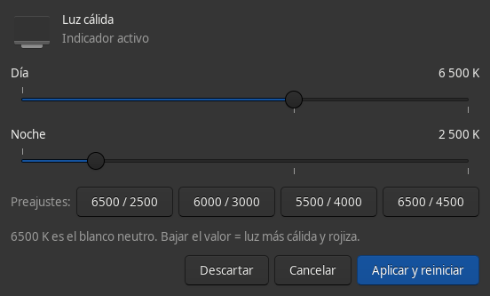

# gammastep-control

Interfaz gráfica para la luz cálida de [gammastep](https://gitlab.freedesktop.org/CameronNemo/gammastep).



## Relación con gammastep

Este proyecto **no es un fork** de gammastep ni incluye nada de su código
fuente. Es una obra independiente que lo usa como **dependencia en tiempo de
ejecución**.

| | |
|---|---|
| Proyecto | gammastep-control (este repositorio) |
| Proyecto del que depende | [gammastep](https://gitlab.freedesktop.org/CameronNemo/gammastep) |
| Autoría de gammastep | Escrito por Jon Lund Steffensen, mantenido por Cameron Nemo |
| Naturaleza de la dependencia | Tiempo de ejecución: proceso externo |
| Código compartido | Ninguno |
| Licencia | GPL-3.0 en ambos lados, por tanto compatible |

De gammastep se usa únicamente su interfaz pública: el formato de
`~/.config/gammastep/config.ini` y las opciones de línea de órdenes
(`gammastep -o -P -O`). Ni se modifica ni se redistribute nada del proyecto
original. El icono `gammastep` que aparece en el menú de aplicaciones
pertenece al paquete de gammastep, no a este repositorio.

Esos puntos son también los puntos de acoplamiento: si gammastep cambia el
formato de su archivo de configuración o renombra el ejecutable o el
indicador, esta app tendrá que actualizarse. Para seguir el estado del
proyecto original: [gitlab.freedesktop.org/CameronNemo/gammastep](https://gitlab.freedesktop.org/CameronNemo/gammastep)
(derivado a su vez de [redshift](https://github.com/jonls/redshift)).

## Por qué existe

El indicador de gammastep que viene en la barra de paneles ya no incluye un
diálogo de preferencias, así que los valores sólo se cambian editando a mano
`~/.config/gammastep/config.ini`. Además, `gammastep` **no recarga la
configuración en caliente**: aunque edites el archivo, el proceso en marcha
seguirá usando los valores antiguos hasta que se reinicie.

Esta app resuelve ambas cosas: sliders para `temp-day` y `temp-night`,
vista previa inmediata del color, y reinicio del indicador al aplicar.

## Requisitos

- Linux (la app localiza procesos leyendo `/proc`)
- `gammastep` instalado
- Python 3 con PyGObject y GTK 3 (`python3-gi`, `gtk3`)

`gammastep-indicator` es opcional: si no está, la app lanza `gammastep` a secas.

## Instalación

```sh
./install.sh
```

Instala en `~/.local` sin necesidad de `sudo`. Para otra ubicación:

```sh
PREFIX=/usr/local ./install.sh
```

O a mano, copiando los dos archivos:

```sh
install -Dm755 gammastep-control ~/.local/bin/gammastep-control
sed "s|@EXEC@|$HOME/.local/bin/gammastep-control|" gammastep-control.desktop \
    > ~/.local/share/applications/gammastep-control.desktop
```

## Uso

Abre *Luz cálida (Gammastep)* desde el menú de aplicaciones y arrastra los
sliders. 6500 K es el blanco neutro; bajar el valor da una luz más cálida y
rojiza.

Al soltar, el color ya está aplicado en pantalla. Al pulsar **Aplicar y
reiniciar** se escriben los valores en `config.ini` y se relanza el indicador.
**Descartar** vuelve a los valores guardados. Si cierras la ventana sin
aplicar, el indicador se restaura con la configuración anterior.

El archivo se escribe de forma atómica (fichero temporal + `rename`) y sólo se
tocan las claves `temp-day` y `temp-night`: cualquier otra clave
(`dawn-time`, `dusk-time`, `fade`, `adjustment-method`, `gamma`, secciones de
proveedores...) se conserva intacta.

## Cómo funciona

Para que la vista previa no se congele, la app suspende el indicador mientras
mueves un slider. La razón es que `gammastep` reaplica las gamma ramps en cada
ciclo del bucle principal, así que cualquier ajuste externo se sobrescribe de
inmediato. Al soltar el slider se aplica la temperatura con un modo de un solo
disparo:

```sh
gammastep -o -P -O <temperatura>
```

y al aplicar, o al cerrar sin guardar, el indicador vuelve a levantarse.

Los procesos se localizan por nombre exacto de ejecutable leyendo `/proc`, sin
`pkill -f`: el patrón de `pkill -f` también coincide con la propia línea de
comandos de quien lo ejecuta y puede matar al shell equivocado.

## Limitaciones conocidas

- La interfaz está en español y los textos no están internacionalizados.
- Sólo se controla la temperatura. El horario de transición (`dawn-time`,
  `dusk-time`), el fundido, el brillo y el método de ajuste se siguen
  editando en `config.ini`.
- Requiere que el ajuste de gamma funcione (`randr`, `drm`...). En un entorno
  Wayland puro depende del compositor.

## Desinstalación

```sh
rm ~/.local/bin/gammastep-control
rm ~/.local/share/applications/gammastep-control.desktop
```

No modifica nada más del sistema: `config.ini` y el indicador se quedan como
estaban.

## Licencia

GPL-3.0. Ver [LICENSE](LICENSE).